# Sakila Movie Rental Portal

React + Express + MySQL, delivered by GitHub Actions, GHCR, and Octopus Cloud
to an Ubuntu WSL2 polling Tentacle. The application uses **Node.js**;
**Python/pytest** verifies the APIs, browser, and deployment tooling.

```mermaid
flowchart LR
    A[Developer: Ubuntu WSL2] --> B[GitHub repository]
    B --> C[GitHub Actions: unit tests]
    C --> D[Build frontend, backend, database images]
    D --> E[pytest: real APIs and Chromium UI]
    E --> F[GHCR: tested versioned images]
    F --> G[Octopus Cloud: versioned release]
    G --> H[Ubuntu WSL2: polling Tentacle]
    H --> I[Docker Compose: port 8092]
    I --> J[Nginx and React]
    J --> K[Express API]
    K --> L[MySQL: persistent volume]
```



## Run locally

Install Docker with the Compose plugin and Python 3.12 or newer. For WSL2,
enable Docker Desktop integration for the **same Ubuntu distribution** where
you run these commands, or install Docker Engine directly inside that distro.

```bash
python3 scripts/init-env.py
docker compose -f docker-compose.yml -f compose.build.yml up -d --build --wait --wait-timeout 240
```

In PowerShell use `python scripts/init-env.py`; the Docker command is identical.
The setup creates an ignored `.env` with random passwords without replacing
existing credentials. Never commit this file.

- Portal: http://localhost:8092
- Database readiness: http://localhost:8092/api/health
- Backend liveness: http://localhost:8092/api/live

Only Nginx is published on the host. The browser calls `/api` through Nginx;
MySQL and Express communicate on private Compose networks. Local access is
bound to `127.0.0.1` by default. Set `APP_BIND_ADDRESS=0.0.0.0` explicitly if
you intend to expose this sample-data portal to your LAN.

The first startup imports the complete official Sakila sample: 1,000 films,
599 customers, and 16,044 rentals. Subsequent starts reuse the named volume.
Database passwords must match the values used when that volume was created;
editing `.env` does not rotate an existing MySQL user's password.

```bash
docker compose ps
docker compose logs --tail 100
docker compose down                 # stops containers; keeps database data
```

Do not use `docker compose down --volumes` on a deployment you want to keep.
Schema/data initialization scripts are for new volumes only. See
[database provenance and license](database/README.md).

## Validate

With the Docker stack healthy:

```bash
npm ci --prefix backend
npm test
python3 -m venv .venv
source .venv/bin/activate
python -m pip install -r requirements-test.txt
python -m playwright install --with-deps chromium
python -m pytest --browser chromium -q
```

In PowerShell use `.venv\Scripts\python` in place of `python` after creating
the virtual environment with `python -m venv .venv`. The Bash deployment tests
run on Linux and are skipped on Windows. Set `SAKILA_BASE_URL` to test a
different URL. Tests assert the original sample dataset counts, so run them
against a sample-data environment; the deployment smoke checks allow changed counts.

Tests cover database readiness, dashboard aggregates, all five lists, searches,
ratings, invalid input, asset serving, desktop/mobile navigation, API failure
handling, release validation, and deployment failure/rollback behavior.

## CI and releases

The workflow is [.github/workflows/pipeline.yml](.github/workflows/pipeline.yml).

1. Pushes and pull requests run Node unit tests and frontend builds.
2. CI builds the three Docker images, starts the full stack, and runs pytest
   API and Chromium tests through port 8092.
3. CI recreates containers and checks that the database data survives.
4. Successful builds on the default branch or `vMAJOR.MINOR.PATCH` tags publish
   those same tested images to GHCR. Feature branches and PRs do not publish.
5. A ZIP deployment package records the commit and exact GHCR image digests.
6. When `OCTOPUS_ENABLED=true`, CD pushes the package to Octopus, creates a
   release, deploys it, and waits for the actual deployment result.

Images are named `ghcr.io/<owner>/<repository>-frontend`, `-backend`, and
`-database`, with unique `build-<run-id>-<attempt>` tags. Releases resolve
images by digest, so a moved tag cannot change an existing release.
Default-branch release numbers use `0.1.<run-number>-ci.<attempt>`.
A tag such as `v0.0.3` creates release `0.0.3`. Existing release `0.0.2` is
not overwritten or assumed to be compatible with the new deployment package.

Base images are pinned by digest, npm uses committed lockfiles, and Dependabot
proposes dependency updates. Updating the MySQL base image requires checking
database upgrade compatibility before promotion.

## Activate Octopus delivery

Follow [the Octopus and WSL2 setup guide](docs/OCTOPUS_SETUP.md) to configure the
target, process, sensitive variables, and GitHub settings for
`https://karthik-devops-lab.octopus.app`.

CD is deliberately disabled until the repository variable `OCTOPUS_ENABLED`
is set to `true`; CI and image publishing still work. A successful local test
does not prove that a cloud release has deployed. The Octopus task must finish
successfully before a live deployment can be reported as successful.

The existing `Jenkinsfile` and `k8s/` files are retained as historical examples.
They are not part of this Docker Compose / Octopus pipeline and have not been
updated or validated for it. Use the commands and process above for this architecture.
